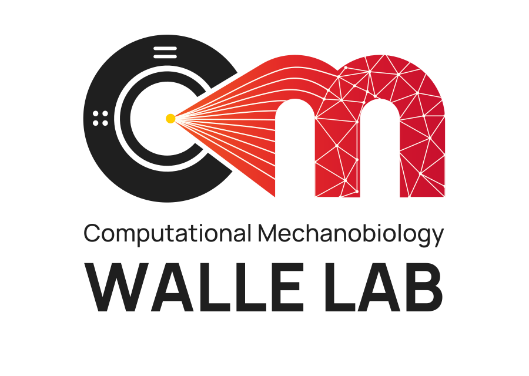

<p align="center">
  
</p>

<p align="center">
  <a href="https://digitalmechanobiology.ca">Lab website</a> ·
  <a href="https://digitalmechanobiology.ca/#research">Research</a> ·
  <a href="https://digitalmechanobiology.ca/brand/">Logos &amp; brand kit</a> ·
  <a href="https://digitalmechanobiology.ca/#publications">Publications</a> ·
  <a href="https://github.com/orgs/walle-lab/repositories">All repositories</a>
</p>

We combine medical imaging, computational modelling, and machine learning to study how mechanical forces shape tissue behaviour.

This is the software home of the **Walle Lab**, led by **Matthias Walle** in the Department of Radiology at the **University of Calgary**.

## User interface tools

Explore images, run analyses, and review results through a graphical interface.

| Tool | Highlights |
| --- | --- |
| [Bone Imaging Toolbox for 3D Slicer](https://github.com/walle-lab/SlicerBoneImagingToolbox) | An integrated interface for Scanco image I/O, contouring, motion grading, longitudinal remodelling, microarchitecture, plate/rod morphometry, voidspace, finite element modelling, and CT spine segmentation. Includes cohort batch processing and consolidated results export. |
| [BoneQuantMRI](https://github.com/walle-lab/BoneQuantMRI) | A MATLAB application for quantitative **³¹P and ¹H bone MRI**: image viewing, ROI segmentation, B1 correction, phantom calibration, measurements, and image export. |

For the Slicer toolbox, start with the [installation guide](https://github.com/walle-lab/SlicerBoneImagingToolbox/blob/main/docs/installation.md) or explore the [tool guides and tutorials](https://github.com/walle-lab/SlicerBoneImagingToolbox/tree/main/docs).

## Microstructure tools

HR-pQCT and microstructural bone analysis, from image preparation to structure, remodelling, and mechanoregulation. These packages can be used directly in Python workflows; many also power the Bone Imaging Toolbox.

| Tool | Highlights |
| --- | --- |
| [bone-contouring](https://github.com/walle-lab/bone-contouring) | Bone and compartment masks with standard contouring methods and optional published HR-pQCT U-Net segmentation. |
| [hrpqct-geodesic-contour](https://github.com/walle-lab/hrpqct-geodesic-contour) | Geodesic active-contour segmentation of fractured distal radii. |
| [bone-microarchitecture](https://github.com/walle-lab/bone-microarchitecture) | Trabecular and cortical BMD and structure: bone volume fraction, thickness, separation, number, cortical thickness, and porosity. |
| [bone-plate-rod-thinning](https://github.com/walle-lab/bone-plate-rod-thinning) | Individual trabecular plate/rod decomposition, full-thickness element maps, and morphometry including thickness, alignment, and junction density. |
| [voidspace](https://github.com/walle-lab/voidspace) | Native, registered, and longitudinal large-voidspace analysis. Supports the toolbox's Functional Bone workflow for measurements excluding large voidspace. |
| [TimelapsedHRpQCT](https://github.com/walle-lab/TimelapsedHRpQCT) | Longitudinal registration, common scan regions, and mapping and quantification of bone formation and resorption. |
| [MultistackRegistration](https://github.com/walle-lab/MultistackRegistration) | Correction of stack-shift artefacts in multistack HR-pQCT acquisitions. |
| [MotionScoreHRpQCT](https://github.com/walle-lab/MotionScoreHRpQCT) | Deep-learning-supported motion grading and image quality assessment. |
| [BoneMechanoregulation](https://github.com/walle-lab/BoneMechanoregulation) | Relates formation and resorption from TimelapsedHRpQCT to local mechanical stimuli using finite element analysis. |

[Browse microstructure tools →](https://github.com/orgs/walle-lab/repositories?q=topic%3Amicrostructure+archived%3Afalse)

## CT tools

| Tool | Highlights |
| --- | --- |
| [spine-segment](https://github.com/walle-lab/spine-segment) | Vertebral CT localisation, identification, and segmentation, including vertebral body/process and cortical/trabecular compartments. |
| [nnUNetManager](https://github.com/walle-lab/nnUNetManager) | Configurable management and execution of nnU-Net models and multi-model segmentation workflows. |

## Finite element modelling — ParOSol

[**parosol-py**](https://github.com/walle-lab/parosol-py) brings the ParOSol micro finite element solver into Python and command-line workflows. Prepare models from label or density images, map material properties, run the bundled native solver, and read mechanical outputs.

Use it for image-based mechanical analysis, including stiffness, failure-load estimates, strain-energy-density fields, and load-history workflows. The [ParOSol interface in Bone Imaging Toolbox](https://github.com/walle-lab/SlicerBoneImagingToolbox/blob/main/docs/tools/parosol-fea.md) provides interactive model setup and result inspection in 3D Slicer.

## Image I/O tools

[**aimio-py**](https://github.com/walle-lab/aimio-py) provides NumPy-based access to Scanco images, masks, scout views, radiographs, and raw detector projections, with Python bindings to Numerics88 AimIO and format-specific readers.

| File type | Read | Write | Data |
| --- | --- | --- | --- |
| **AIM** | `read_aim()` | `write_aim()` | Reconstructed images and masks, with image geometry and processing logs. |
| **ISQ** | `read_isq()` | — | Reconstructed volumes, with optional density/BMD or HU conversion. |
| **SCV** | `read_scv()` | — | Scout-view images. |
| **GOBJ** | `read_gobj()` | — | Contours rasterized into binary volume masks. |
| **RAD** | `read_rad()` | — | Native 2D projection radiographs. |
| **RSQ** | `read_rsq()` | — | Raw detector projections, including optional read-only memory mapping. |

Use **`read_image()`** to read any of these formats through one entry point, and **`image_info()`** or the **`aimio-info`** command to inspect headers. Format-specific metadata helpers, processing-log conversion, and AIM/ISQ density or HU conversion helpers are also available.

```sh
pip install aimio-py
```

## Using and contributing

Each repository documents its installation, supported inputs, licence, and citation guidance. Open an issue in the relevant repository to report a problem or discuss a contribution. Please cite the software and associated methods when using them in research.
